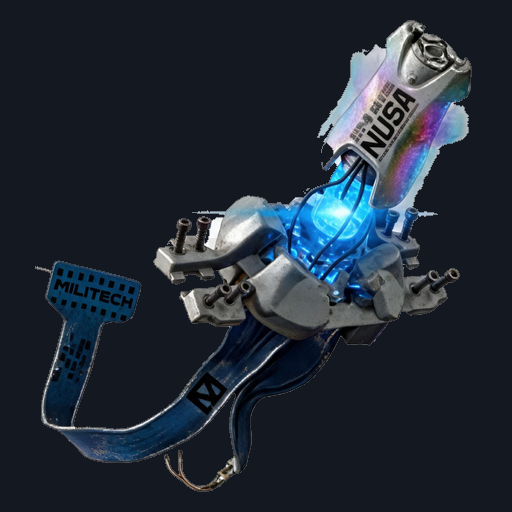

# Сандевистан Militech «Надежда» (Hope) — мод для Cyberpunk 2077 2.5

Новый легендарный имплант (Tier 5) в слот операционной системы: экспериментальный Сандевистан Militech для спецподразделений NUSA.
Он почти останавливает время, но плохо держит нагрузку: если активировать его слишком часто подряд, он перегревается.



## Характеристики

| Уровень  | Замедление времени | Длительность | Полная перезарядка | Перегрев наступает |
|----------|--------------------|--------------|--------------------|--------------------|
| Tier 5   | 95 %               | 5 сек        | 10 сек             | на 4-й активации подряд |
| Tier 5+  | 97 %               | 7,5 сек      | 10 сек             | на 4-й активации подряд |
| Tier 5++ | 99 %               | 10 сек       | 10 сек             | на 3-й активации подряд |

### Бонусы

| Бонус | Tier 5 | Tier 5+ | Tier 5++ |
|---|---|---|---|
| **Боевая прошивка** (всегда, пока установлен) | +10 % к урону крит. попаданий, +5 % к шансу крита, +12 к выносливости | +10 % к урону крит. попаданий, +7 % к шансу крита, +12 к выносливости | +10 % к урону крит. попаданий, +10 % к шансу крита, +12 к выносливости |
| **Протокол «Охотник»** (пока активен Сандевистан) | +15 % к урону в голову, +10 % к шансу смягчения урона, +50 к броне | +20 % / +15 % / +70 | +25 % / +20 % / +90 |
| **Адреналиновый контур** (за убийство под Сандевистаном) | 20 % выносливости | 20 % выносливости + 5 % здоровья | 25 % выносливости + 8 % здоровья |
| **Протокол «Последняя надежда»** | — | — | пули не замедляются: летят с обычной скоростью и попадают мгновенно |

* **Заряды.** Работает на шкале заряда, как «Апогей». Можно активировать снова, не дожидаясь полной перезарядки, если в шкале остался заряд. Убийства во время замедления возвращают 10 % заряда.
* **«Последняя надежда» (только Tier 5++).** Обычно во время Сандевистана пули превращаются в медленные видимые снаряды. С «Надеждой» Tier 5++ огнестрельное оружие V стреляет как без замедления: попадание засчитывается сразу. Техническое (Tech) оружие игра и так не замедляет, для него ничего не меняется.
* **Изъян — перегрев.** Можно сделать 3 активации подряд (2 на Tier 5++). Следующая активация вызывает ошибку перегрева:
  * Сандевистан сразу отключается;
  * заряд обнуляется;
  * имплант блокируется на 12 сек и за это время полностью перезаряжается.

  Перед перегревом на экране появляется предупреждение.
* **Что такое «подряд».** Серия сбрасывается, если перед активацией шкала заряда полная (≥ 99 %) или с последнего выключения прошло больше 12 сек.
* **Прочее:** иконный имплант, занимает 50 единиц вместимости киберпрограмм (человечности). Улучшается у риппердока: Tier 5 → 5+ → 5++.

## Как получить

### 1. Консоль (Cyber Engine Tweaks)

```lua
Game.AddToInventory("Items.MilitechHopeSandevistan", 1)
```

Через встроенный помощник мода:

```lua
GetMod("MilitechHope").give()      -- Tier 5
GetMod("MilitechHope").give(2)     -- сразу Tier 5++
```

Когда открыт оверлей CET, появляется окно **Militech Hope Sandevistan** с кнопками для тех же действий.

### 2. Побочное задание «Надежда» (нужен 40-й уровень)

1. Приезжайте в **Уотсон, на набережную Арасаки** (Arasaka Waterfront, район «Конпеки Плаза»).
   * Если уровень ниже 40, придёт зашифрованное сообщение: его можно прочитать только с 40-го уровня.
2. С 40-го уровня придёт SMS от неизвестного контакта, и на карте появится метка.
3. Езжайте на **кладбище, к колумбарию** (Night City Columbarium, Северная Окленд / Норт-Оук). Рядом с меткой стоит ящик Militech, Сандевистан лежит в нём.
4. Заберите имплант из ящика — задание выполнено.
   * Если ящик почему-то не открывается, постойте рядом ~25 сек: имплант передадут напрямую.

Помощники для задания в консоли CET:

```lua
GetMod("MilitechHope").quest()        -- текущий этап задания
GetMod("MilitechHope").resetQuest()   -- начать задание заново
```

## Требования

| Мод | Версия (для игры 2.5) |
|-----|------------------------|
| [RED4ext](https://github.com/wopss/RED4ext) | 1.31+ |
| [redscript](https://github.com/jac3km4/redscript) | 1.0+ |
| [TweakXL](https://github.com/psiberx/cp2077-tweak-xl) | 1.12+ |
| [Codeware](https://github.com/psiberx/cp2077-codeware) | 1.21+ |
| [Cyber Engine Tweaks](https://github.com/maximegmd/CyberEngineTweaks) | 1.38+ (необязательно, для консоли) |

## Установка

### Автоматически — `MilitechHope_Installer.exe` (рекомендуется)

1. Скачайте `MilitechHope_Installer.exe` из [Releases](../../releases) и запустите.
2. Установщик сам найдёт игру (Steam, GOG, Epic). Если не нашёл — нажмите «Обзор…» и укажите корневую папку игры.
3. Отметьте компоненты. По умолчанию выбраны мод и те из обязательных модов, которых ещё нет в игре:
   * RED4ext, redscript, TweakXL, Codeware — обязательно;
   * Cyber Engine Tweaks — рекомендуется;
   * ArchiveXL — по желанию.
4. Нажмите «Установить». Моды скачиваются в последних версиях из их официальных релизов на GitHub, а сам мод «Надежда» уже встроен в exe.

Если в папку игры нельзя писать (например, `C:\Program Files`), установщик предложит перезапуститься от имени администратора. Кнопка «Удалить мод» убирает только файлы «Надежды».

Для продвинутых пользователей есть тихий режим:

```
MilitechHope_Installer.exe --silent --game "D:\Games\Cyberpunk 2077" [--all | --only red4ext,redscript,tweakxl,codeware,cet,archivexl,militechhope] [--log install.log]
MilitechHope_Installer.exe --silent --game "D:\Games\Cyberpunk 2077" --uninstall
```

Для работы установщика нужны Windows 10/11 (.NET Framework 4.8 там уже есть) и интернет для скачивания модов-зависимостей.

### Вручную

Распакуйте zip из [Releases](../../releases) в папку игры (`Cyberpunk 2077/`). После распаковки должны появиться:

```
archive/pc/mod/MilitechHope.archive                       — иконка
r6/tweaks/MilitechHope/militech_hope.tweak                — предмет, уровни, статус перегрева
r6/scripts/MilitechHope/*.reds                            — перегрев, пули Tier 5++, задание, тексты (RU/EN)
bin/x64/plugins/cyber_engine_tweaks/mods/MilitechHope/    — консольный помощник CET
```

Удаление: удалите эти файлы. Перед удалением снимите имплант.

## Структура репозитория

```
src/                      файлы мода в структуре папок игры
source/raw/…/*.png        иконка 160×160 с прозрачным фоном (размер слота инвентаря)
source/archive/…/*.json   inkatlas в формате WolvenKit JSON
assets/                   исходный скриншот и превью иконки
tools/make_icon.py        вырезает фон из скриншота и пересобирает иконку
tools/gen_tweak.py        генерирует militech_hope.tweak из таблицы значений по уровням
tools/validate.py         проверки исходников, запускаются в CI
installer/                установщик MilitechHope_Installer.exe (C#, .NET Framework 4.8)
.github/workflows/        сборка .archive через WolvenKit CLI и публикация релиза
```

Релиз собирается автоматически. GitHub Actions:

1. упаковывает иконку через WolvenKit CLI 10;
2. собирает zip и установщик;
3. проверяет установщик на тестовой папке игры;
4. при пуше тега `v*` публикует всё в Releases.

## Настройка

Все числа для перегрева и задания вынесены в `r6/scripts/MilitechHope/Config.reds`: лимиты активаций, время сброса серии, координаты зоны и ящика, требуемый уровень.

Параметры самого Сандевистана (замедление, длительность, перезарядка, бонусы) задаются в `r6/tweaks/MilitechHope/militech_hope.tweak`.
